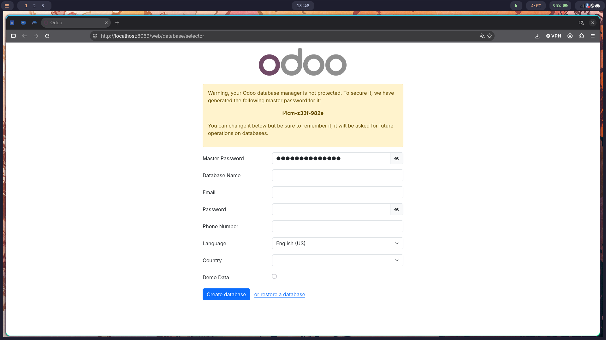

# Actividad RA2
> Descargamos el `docker-compose.yml` que nos ofrece el profesor, y lo pegamos en el **directorio** donde vayamos a
> levantar el servicio de `docker`

## Iniciamos el docker
```Bash
    docker compose up -d
```
> Con el servicio de docker levantado, usamos `docker ps` para ver si el servicio en segundo plano, se está **ejecutando**.
> Después de ejecutarlo, accedemos a nuestro navegador y buscamos en la **URL:** [Odoo web](http://localhost:8069)

### Debería mostrar el navegador la siguiente pantalla:

---